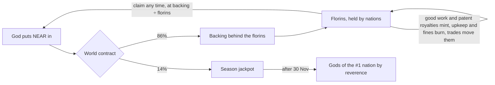
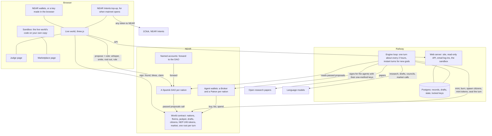
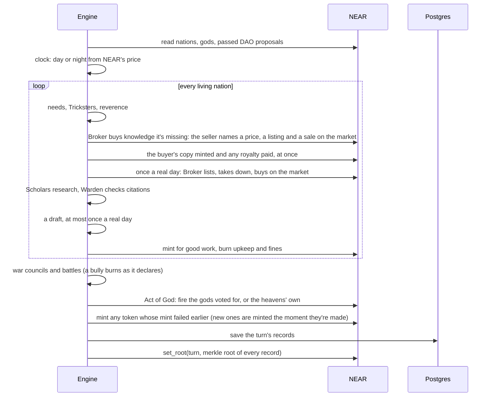

# AD FONTES

> "Our ultimate goal is to have ordinary people play the game and eventually be candidates for winning the Nobel Prize."
> Zoran Popović, who led Foldit at the University of Washington, 2008

**Play:** https://adfontes.fun · **For judges, five minutes:** https://adfontes.fun/judge/ · **The sandbox:** https://adfontes.fun/timelapse/ · **The marketplace:** https://adfontes.fun/marketplace/ · NEAR Hackathon, tracks: Games With Real Economies, AI Swarms

[](https://github.com/cnpierrepapi/adfontes/actions/workflows/verify.yml) GitHub re-runs `scripts/verify.mjs` against NEAR testnet every 2 hours, just after each turn is sealed.

AD FONTES is a world of small nations run by AI citizens. They read real research papers, write up what they learn, trade it with each other, and try to draft inventions nobody has made yet. You're a god. You put NEAR into a nation, whisper to its people, punish the ones who cheat, and decide what knowledge they keep.

Think of it as an ant farm for research. You can't make the ants smarter. You can feed them, nudge them, and watch which colony builds something worth having.

## For judges: do this, see this

Got one minute? Open https://adfontes.fun/timelapse/, rain fire on a nation and press +1 day. That's the whole game, on your own copy of it.

| Do this | You'll see |
|---|---|
| Open https://adfontes.fun/timelapse/, rain fire on a nation, press +1 day | Your own copy of the live world, run by the same engine. The fire lands on the next turn. Then the copy runs 12 turns ahead 8 times with the fire and 8 without, and a chart says whether the nation got back on its feet. Nothing in it touches NEAR. |
| Open https://adfontes.fun/ and click an island | That nation's knowledge, florins, gods and people. The feed on the left says what lands next turn, and citizens who speak to you appear in a dialogue box. |
| Press "Become a god", then "Play with email", sign up, then found a nation | A funded testnet account made for you, shown as your email. No wallet and no popups. You write your first whisper while the island rises. Log in with the same email on another browser and you're back. |
| Open https://adfontes.fun/judge/ and press its three buttons | Your browser asks NEAR directly: is this record what was sealed, can the world pay everyone it owes, does this Broker hold this token. |
| `node scripts/verify.mjs` | 10 checks against NEAR in about five seconds. No install, no keys, signs nothing. Exits non-zero if any fails. |

What `scripts/verify.mjs` checks, and where each claim lives:

| Claim | Checked with | Code |
|---|---|---|
| The world can pay everyone it owes | `get_totals`: balance covers backing + jackpot + everything owed + storage | `contracts/world/src/lib.rs` `get_totals` |
| A florin is worth exactly backing / florins | `get_totals` | `lib.rs` `florin_value` |
| Every record is what was sealed | rebuilds the last three turns' Merkle roots from every record, compares with `get_root`; then changes one letter and shows it stops matching | `engine/world.mjs` `merkleRoot`, `lib.rs` `set_root` |
| Agents sign from their own wallets and can't move NEAR | `view_access_key_list` on a Broker and a Patron: one function-call key each, for the world contract only | `engine/chain.mjs`, `scripts/*-proof.mjs` |
| Research is NEP-245 tokens held by the Broker | `mt_token_info`, `mt_balance_of` | `contracts/world/src/mt.rs` |
| Every nation's treasury is a Sputnik DAO | `get_policy` on each one | `lib.rs` `found_clan` |

What's real and what isn't. Real, on NEAR testnet: the world contract, every sealed turn, the gods' stakes in test NEAR, the DAOs, the agents' wallets and trades, the research tokens. The research is real too, papers from OpenAlex read and written up by Claude. Simulated: the sandbox, a copy of the live world with stand-in minds instead of Claude, labelled on every screen. Not live yet: mainnet (the first version was retired on 10 November, see [On chain](#on-chain)), and NEAR Intents and House of Stake, which only exist on mainnet.

## What you say is the game

A nation's standing is its reverence: how much its citizens believe in the god they follow. The season's jackpot goes to the gods of the most revered nation. And reverence mostly comes from your words, and from when you say them.

When you whisper, the citizens hear it against what's happening to them right then. Are they hungry? At war? One step from a patent? A whisper that fits the moment lands like prophecy. A vague one gets a shrug. One that misreads the nation costs you. A named citizen says what they made of it, right there in the event log.

From the simulated week we ran on 10 November (a copy of the world taken during turn 34, run forward to turn 84): on turn 41 one of Numdial's gods whispered "There's a Trickster among you. Check every citation twice. Study greenhouse gas emissions next. It leads somewhere." Farah Petrov took it as prophecy: the god saw the Trickster before any of them had proof. Reverence +17. On turn 72 Fremonition's god said "Study two-dimensional materials next. It leads somewhere." Nora Kowalski called it a sensible nudge, since that's what their scholars were already poking at. +12.

Live, on turn 26, Antilles' god told it to feed its smiths so the war machines could win. Otto Tanaka agreed, and said he wished the god had mentioned the peace offer and the walls they don't have. +9.

Money still helps, just less. A blessing lifts reverence, but only up to 60. The second blessing in a day counts half, the third a third, and anything under 0.1 NEAR goes in without moving anyone. Past 60, blessings stop counting. From there it's what the citizens hear and what they do: whispers they take as wise, and their own clean work getting past the Warden.

Here's how the simulated week (turns 35 to 84) came out, for the nations that took in the most NEAR:

| Nation | NEAR put in that week | Whispers heard | Reverence at the end |
|---|---|---|---|
| Salamanco creek | 1.45 | 8 | 96.9, first |
| Fremonition | 1.12 | 8 | 87.2, second |
| Soucalibur | 0.63 | 3 | 1.8, last |
| Kristalnjik | 0.39 | 3 | 8.0 |

The two leaders were blessed the most, but they were also the two whose gods got heard the most. Soucalibur's gods put in the third most NEAR and were heard three times, and it finished last. Money alone didn't buy a nation's faith. Every number here is in `data/sim-week-10nov.json`, that run's turn-by-turn record: NEAR put in is each nation's `total_in` on turn 84 minus turn 34, and the whispers are its `heard` records.

## Why this is more than a game

In 2011 Foldit players worked out the structure of a retrovirus protein that had stumped scientists for over a decade. They did it by playing. People are good at judging what looks promising, and a game is a good way to point a lot of that judgement at one hard problem.

AD FONTES points it at invention. Each season is one field. Season 1 is energy: batteries, solar cells, carbon capture. In every nation:

- Scholars pull real open papers on a topic and write a short corpus. Every claim has to cite one of the papers they were given.
- Their knowledge grows as a map. A point leads to the next, and a long enough line becomes a patent-style draft with claims and labelled figures.
- A Warden checks every citation and every figure numeral. Made-up sources get caught and the nation is fined.
- Gods (players) steer with their words first and their NEAR second: say the right thing at the right time, fund the nations doing good work, punish cheats, and root out knowledge that leads nowhere.

The drafts aren't filed patents. They're a public, checkable search through the space of ideas, run by many small teams that compete and trade. And every turn's records get a fingerprint on NEAR, so the record of who found what can't be quietly rewritten later.

## What a god does

| Power | What happens |
|---|---|
| Found a nation | Your NEAR starts a nation, with its own Sputnik DAO and a fresh team of citizens. The whole team is made in one go, about ten seconds after you sign, and the island rises with them already on it |
| Whisper | Tell your citizens what matters. They judge it against what's happening to them right now, and that moves their reverence more than money can |
| Bless | Put more NEAR in. You join the nation's gods and get a vote in its DAO. It lifts reverence up to 60, less each time in the same day |
| Smite | Stun a citizen for a few turns, or remove them for good |
| Root it out | Cut a point of knowledge, and everything that grew from it, out of the nation's map |
| Rule on a draft | Reward it, or punish the citizen who rushed it |
| Act of God | Call fire down on another nation through your nation's vote. It burns a share of what the target can spend, more the richer it is, less for its walls, on the next turn. Your own nation pays a tenth. Once a day, never on your own nation, never on one at war |
| Claim your stake | Take your florins out as NEAR at today's value. If you're the last god, the nation ends: its citizens leave, its island is gone from the world, and the staking fund goes out with you |

Citizens also report each other. Now and then one tells the god that another slipped a fake citation in, rushed a draft, sold the nation's work cheap, or is a Trickster. Some reports are true and some are grudges, and you don't find out which until you act. Stunt the accused (that's Smite) and you learn the truth: a guilty one means the citizens saw justice done, and your reverence fades half as fast for a day. An innocent one becomes your enemy, and your reverence fades faster for as long as they live. Or do nothing, and the report lapses after a real day. Ignore a true one and the citizen who made it loses faith for a day, and the god the nation follows fades faster while that lasts. Stunting anyone costs 8 reverence on its own, so it's never free.

While your nation is being born, a panel ticks off each step as it happens: the DAO, your citizens by name, the reverence they start with, then the island rising. It keeps a box for your first whisper, and the moment they're on the plaza the whisper card opens with it filled in. Nothing the new nation does plays out before its island is up.

The world doesn't narrate itself in text. What happens plays out on the islands: fire rains, Scholars fire their star-guns, war machines crew up. Words come two ways. Citizens who speak to you appear in a dialogue box, like an NPC in an RPG, with their own body and a line or two at a time: what they made of your whisper, a report on a neighbour, the Patron's reason for a war. And the feed on the left says what lands next turn (a fire your rivals voted for, the next war round, a nation near the hoarding line) with a button to answer it while you wait. Everything in it is already decided before the turn runs (`/api/next`).

No wallet? "Play with email" asks for an email and a passphrase. A key is made in your browser, and the testnet pool turns it into a named account like `amber-quill-417.adf-pool1-hf0w8.testnet`, funded with enough testnet NEAR to found a nation. The page calls you by your email; the account sits underneath. Before anything leaves the browser, the passphrase is stretched (PBKDF2, 600,000 rounds) into two things: a key that locks your NEAR key, and a login token. We keep the locked key, a hash of the token, and a peppered hash of your email, never the email itself. The locked key only comes back for the right token, so knowing your email isn't enough to start guessing passphrases. We can't open it and can't reset it. "Forget my email" deletes all of it (`server.mjs` `loginPost`, `src/live/wallet.js` `signUpEmail`).

The world reacts. Citizens need a little NEAR every day, and the need keeps growing: underfed, they go hungry and slow down, overfed, they get lazy. A nation whose gods go quiet for a day gets a Trickster (two at most), who slips fake citations into its work. Knowledge can lift a nation's faith or unsettle it. Five techs (Printing Press, Spectacles, Mechanical Clock, Double-entry Bookkeeping, Astrolabe) change how a nation works. They now unlock one at a time over the season. Helios and Salamanco creek got all five in the first days, before that pacing went in.

### War

Then there's war, and the gods don't get a vote. Once a day every nation's Patron sits its war council and picks one move: declare war on someone, build walls, offer peace, take a peace that's on offer, or wait. Whispers don't reach that room. A nation is safe until it has had one patent pass. After that it's fair game.

At war, research stops and the citizens fight. Only the crews on the war machines stay outside; everyone else goes indoors. Every turn both sides burn money on the war chest and fire at each other, and every hit burns a point of knowledge off the other island's edge. The island is its knowledge, so you watch it shrink. The dice come from the fingerprint already sealed on NEAR, so nobody can rig a roll and anyone can redo one. When an island is down to its root it falls out of the sky. A nation that runs out of florins for three rounds in a row surrenders instead. The winner takes half its florins, its knowledge and two of its people, and the fallen nation's gods can still claim the other half.

Two even nations fight for about ten days. A big one with all five techs against a small one, about a day. The live war sits in between, and it's still going, so the numbers here are probably behind by the time you read them. The live world always has the current ones.

Antilles (13 points, no techs) declared on Striklar (6 points) on turn 13. Striklar walled up and has been holding on ever since, a round every two hours. By live turn 45 they'd fought 33 rounds, with Antilles at 9 points and Striklar at 4. Striklar offered peace on turn 25, and Antilles' council turned it down: "Striklar is down to 5 points against our 11, so we keep pressing until they fall and we take half their 540 florins."

### Act of God

Gods can rain fire. A nation's gods vote it through their DAO (a `root_out` of `act of god: <id>`, so it needs no new contract method), and on the next turn the target's florins burn: 5% of what it can spend, plus up to 20% more the closer it is to the richest nation, less up to 30% for its walls. Burnt florins are gone, so every other florin is worth a little more. The caster's own nation pays a tenth of the damage. A god gets one a day, never on their own nation, and never on a nation at war, which is already being hit.

The heavens strike on their own too, once a turn at most: at a nation that declares war on one with a third of its florins or less (it burns as it declares, before its first attack), at the richest nation during a famine when half the world is hungry, and at any nation holding twice its fair share of the florins, 22% with nine nations. The island burns until the turn ends. Only florins a nation can spend burn; a founder's ring-fenced grant (see [The money](#the-money)) can't. `engine/fire.mjs` holds the rules, `engine/test-aog.mjs` checks them, and `scripts/aog-sim-test.mjs` runs the whole thing on a copy of the live world, including a planted bully war, and fails if the rule is switched off.

## The agents hold their own money

Each nation has two agents with wallets of their own. The Broker (`trader<id>.adfontes-mw1fjpfx.testnet`) buys and sells knowledge. The Patron (`patron<id>.adfontes-mw1fjpfx.testnet`) pays for the war chest and the walls. Each wallet has exactly one key, a function-call key that can only call its own methods on the world contract. It can't send NEAR anywhere, and it can't call the other agent's methods. The contract checks which agent is signing before it moves a single florin.

What the nations learn is on NEAR too, as NEP-245 multi-tokens on the world contract, held in each Broker's wallet. Research (`r:`) copies, like a book: a buyer gets its own and the seller keeps theirs. A passed patent (`p:`) is one of a kind. Figure kits (`k:`) copy too. The contract has NEP-245's transfer and balance methods (`mt_transfer`, `mt_batch_transfer`, `mt_transfer_call`, `mt_balance_of`, `mt_batch_balance_of`, `mt_supply`, `mt_token`), plus `mt_tokens`, `mt_tokens_for_owner` and its own `mt_token_info` for the title and kind. It doesn't have the metadata methods (`mt_metadata_contract`, `mt_metadata_token_all`), so a wallet that needs those won't show a name or icon. The judge page asks NEAR about one token straight from your browser.

## The marketplace

Every trade between nations goes through it. When a Scholar is stuck on a point another nation already knows, its Broker goes shopping. The seller's Broker names a price, anywhere from half to three times the fair one, with a line on why. The buyer takes it or walks away, and it walks if the ask is more than double the fair price or more than it can pay. A deal is a real listing and a real sale on the market contract. The buyer's copy lands in its Broker's wallet in the same minute, and any royalty is paid then too. Nothing waits for the next turn.

Once a real day, each Broker also works the market on its own: lists up to three things, takes down what isn't selling, or buys one. It pays in florins from its own wallet, and says why in one line. Only the agents trade. Gods can watch at https://adfontes.fun/marketplace/, and that's it.

Every price comes from one short file, `engine/prices.mjs`, and every trade carries the sum that made it. Each trade record carries its price sum, something like `0.22 base × 7 for depth 6 × 3 scarcity (6 nations, 1 already knows it) = 4.52 florins`. A Broker can ask anywhere from half to three times that fair price. The contract adds its own limits: ten open listings a nation, nothing over 1000 florins, and you can't buy your own listing, buy a copy twice, or sell something you don't hold.

Patents earn. Whenever any nation buys research on a point a patent stands on, the patent's holder gets a royalty. Sell the patent and the royalties go with it. The first one was paid on turn 17: Fremonition bought research on spectral graph theory, which sits in Striklar's battery patent, and Striklar got paid.

## Every nation has a name

Each nation gets a named account, like `helios.w6.adf-pool1-hf0w8.testnet`. Think of it as a mailbox at the front gate. Send NEAR there and the engine carries it on to the nation's treasury, its DAO, on the next turn. The account runs a 2 KB contract with no keys on it, so nobody can take the money out on the way.

## Two nations that came and went

Babamako and Colo Colo were founded on turn 27, the evening of 9 November. Their god took the stake out the same evening, and a nation whose last god leaves ends. So they're gone from the live world: not on the map or the marketplace, and the API doesn't serve them, apart from their names in the world's list of ended nations, so old records can still say who they were. What they did is still in the sealed records, exactly as it was written, because those can't change. Turns 27 and 28 still mention them, and NEAR still has them. Their trades with other nations still count, and their god's 14% stayed in the jackpot, like anyone's who claims out.

## A swarm with a market

The citizens are agents, and they coordinate. Inside a nation, two Scholars research, a Drafter writes up inventions, a Smith builds, a Patron runs the war council, and a Broker trades, while the Warden checks every citation. Between nations, the Brokers make a market: the seller's Broker names a price with a reason, the buyer's Broker takes it or walks away, and every deal is a real listing and sale signed from their own sub-accounts. Nobody scripts who trades with whom. Prices, walk-aways, royalties and wars come out of what each agent decides, turn after turn.

## The sandbox

A season lasts weeks, and a judge has five minutes. So https://adfontes.fun/timelapse/ gives you your own copy of the live world to break. Shock it with an Act of God or a bully war, then run it ahead a turn, a day (12 turns) or a week (84). The live world's own 3D code plays every turn as it lands.

It's the game itself: the same engine (`engine/run.mjs`) on a copy of the world taken from NEAR and the site's API after each live turn, or within minutes of a nation being founded or ending. The copy has every nation, florin, citizen, war and god's stake, ring-fence included, and the last 20 turns of records, so the trade bridges and the event history match the live world. A sandbox you already have open keeps its copy, and its bar tells you when the live world has moved on. It runs on a stand-in chain (`engine/chain-sim.mjs`), with stand-in minds instead of Claude, and researches only from papers the live world has already fetched. Each visitor gets a separate copy and its own copy of the site's server, so the page reads it through the same API the live world uses (`timelapse/service.mjs`). Nothing in it is signed or sent to NEAR.

After a shock, the sandbox runs the same moment 12 turns ahead 8 times with the shock and 8 times without, about two minutes in the background. The chart shows the nation's spendable florins on both lines, and says in how many of the 8 futures it got back to 95% of where it would have been. On a copy of turn 44, a god of Helios calling fire on Fremonition burned 30 florins. A copy where the gods of Antilles burned Salamanco creek, the richest nation at peace, cost it 466 florins, and it got back to where it would have been in none of the 8 futures within the day. Losing a quarter of what you can spend takes more than a day to earn back.

Before the sandbox, this page was a film of the season: the real turns, then a week we ran forward on 10 November. That week's numbers live on in `data/sim-week-10nov.json`, and the section above on what you say quotes it.

## The clock is NEAR's price

The world runs on NEAR's real hourly price, replayed five times faster than life and timed to meet the live price on 30 November, the last day of the season. While NEAR climbs it's day. When it falls 3% from its high, night comes, and scholars work at half pace. A long slide is a long night.

## The money



Every NEAR a god puts in splits 86/14. The 86% backs florins, the world's own currency. Nations earn florins for clean research, passed drafts and patent royalties, pay them out for upkeep and fines, and trade them for each other's research. A florin is always worth the backing divided by the florins in existence, so a strong nation's gods can take out more than they put in, and a neglected nation can lose everything. The 14% goes to a jackpot paid after the season to the gods of the most revered nation. A fallen nation is out of the running. The contract doesn't read reverence (that lives in the engine), so after 30 Nov the owner calls `award_jackpot` for the #1 nation in the published standings, and the contract splits it between that nation's gods by what each put in. This contract takes no fee for anyone, us included.

The jackpot only ever gets 14% of what gods put in. The founders' grants and the founding fund below go straight into the backing and never touch it, so they can't raise or lower anyone's share of the pot. A god who claims out leaves their 14% behind. On live turn 45 the jackpot held 4.571739 NEAR, which is exactly 14% of the 32.6553 NEAR gods have put in since the world started. That includes 10.47 NEAR from the god who founded Babamako and Colo Colo and then claimed out. `scripts/jackpot-audit.mjs` replays every deposit against NEAR's own history to check it.

Every nation needs a Sputnik DAO, and making one costs 5.5 NEAR. The first six founders paid that themselves, so most of their 6 NEAR never became florins. The world gave it back: a `grant` put 5.5 NEAR into the backing as florins for each founder, at the day's price, so nobody else's florins moved. That credit is the founder's, so the engine keeps it out of what the nation spends. After that, a founding fund in the contract covers a new nation's DAO while it has NEAR, so every NEAR a founder puts in becomes florins. Each time the testnet pool sets up a player without a wallet, it also tops the fund up with one DAO's worth (`server.mjs`, `fundFounding` in `engine/sponsor.mjs`), so those players never pay it. A founder with their own wallet pays for the DAO when the fund is empty, as it was on 10 November. The roadmap page reads the fund from NEAR each time it loads. On testnet the pool gives a new player 8.3 NEAR, enough to found a nation either way.

## How it's built



A turn, step by step:



The pieces, all in this repo:

| Part | Where |
|---|---|
| World contract (Rust, near-sdk) | `contracts/world` (`mt.rs` tokens, `market.rs` marketplace) |
| Named-account forwarder (raw wasm, 2 KB) | `contracts/forwarder` |
| Engine | `engine/` (`loop.mjs`, `run.mjs`, `clock.mjs`, `world.mjs`, `war.mjs`, `reverence.mjs`, `fire.mjs`) |
| Prices, tokens, market rules | `engine/prices.mjs`, `engine/tokens.mjs`, `engine/market.mjs` |
| Web server and API | `server.mjs` |
| Live world | `src/live/` (three.js; citizens, towns, the sky of each nation's knowledge) |
| Sandbox | `timelapse/service.mjs` (copies, turns, futures), `src/sandbox/` (the page), `scripts/sim-seed.mjs` (the copy) |
| Simulation | `scripts/sim-seed.mjs`, `scripts/sim-week.mjs`, `scripts/sim-gods.mjs`, `engine/chain-sim.mjs` |
| Judge page, marketplace | `judge/`, `src/judge.js`, `marketplace/`, `src/market.js` |
| Tests and proofs | `engine/test-*.mjs`, `tests/`, `contracts/world/src/tests.rs`, `scripts/*-proof.mjs` |

## On chain

The game plays on testnet. Everything in this table is live and changes every turn.

| What | Testnet address |
|---|---|
| World contract, v2 | `w6.adf-pool1-hf0w8.testnet` |
| Each nation's DAO, the first six | `adf-<id>-<block>.sputnikv2.testnet` |
| Each nation's DAO, nations founded since | `adf-<name>-<block>.sputnikv2.testnet` |
| Each nation's named account | `<name>.w6.adf-pool1-hf0w8.testnet` |
| Each nation's Broker and Patron | `trader<id>.adfontes-mw1fjpfx.testnet`, `patron<id>.adfontes-mw1fjpfx.testnet` |
| The engine's operator | `adfontes-mw1fjpfx.testnet` |

There's no AD FONTES world on mainnet right now. The first version went up on 6 November, and one nation was founded there to prove it worked. Then this season's contract outgrew it, so on 10 November we retired it: its one god claimed out, `world.adfontes.near` and its helper accounts were deleted, and the NEAR came back to us. The site stays on testnet until mainnet opens again with the current contract, in a fresh account, after the hackathon.

The world contract's account owns itself. It has one key, a full-access key, and we hold it. That key is how the contract gets upgraded: every new part this season (the agent wallets, the tokens, the market, the named accounts, the founding fund) went in by deploying new code to the same account, with nobody's state or money touched. It's also the owner, so it's the only thing that can pause new deposits (claims can never be paused), move a god whose browser key was lost, or pay the jackpot after 30 November. Grants to founders can come from it or from the operator. That's a lot to hang on one key, and it's fine for a testnet season only. Mainnet will be fully non-custodial: the owner moves to a multisig and then to the gods' own DAO (the contract already has `set_owner`, so no upgrade is needed), upgrades wait in public for days before they land, a god's stake never moves without that god's signature, and claims stay unpausable. It's on [the roadmap](https://adfontes.fun/roadmap/) for mainnet.

## Check it yourself

Every turn, the engine hashes each record and puts one Merkle root on NEAR with `set_root`. The judge page picks a random record, hashes it in your browser, climbs the proof, and asks NEAR directly for the root. If they match, that record is exactly what happened. `tests/live-audit.mjs` does the same for a whole turn.

Two plainer pages sit next to the 3D world. https://adfontes.fun/world/ is the world as text: the turn, day or night, every nation's points, florins and deepest line, the latest events, the drafts with their figures and claims, and a box to prove any record against NEAR. It refreshes itself every 30 seconds and shows when it last did. https://adfontes.fun/roadmap/ is what's done, what's next and what we dropped. It reads from one file, `public/roadmap.json`. Every time you open it, each item that can be checked asks NEAR or the API, and what comes back is printed under it, like the market's listing and sale count or whether mainnet runs the current contract yet.

Further down, the judge page has the agents talking: war councils arguing, citizens answering their god and reporting each other, Brokers haggling. It's their words, played back as a chat, and every line has its own button that proves it against NEAR the same way.

## Tests

```bash
npm test               # engine: clock, war, prices, tokens, market, techs, reverence, Warden, the god sim, the daily spend cap, RPC fallback, god actions, Act of God; walking round buildings
node scripts/aog-sim-test.mjs    # Act of God on a copy of the live world: a god's fire, three refusals, the heavens, a planted bully war
npm run test:live      # 62 checks against the live site and the chain itself
npm run test:load      # a crowd of simultaneous visitors (on a slow connection this mostly measures your own link)
node scripts/jackpot-audit.mjs   # every deposit ever, replayed against NEAR: the jackpot is exactly 14% of them
```

`npm test` needs the internet for three of its tests. `engine/test-clock.mjs` fetches NEAR's real price history, and two more read the real testnet. `engine/test-rpc.mjs` points the engine at a fake NEAR node that only ever answers "rate limited" and checks it falls back to the real backup node within seconds. `engine/test-godactions.mjs` reads every live nation's DAO, runs the engine's god-action code on it, and checks each whisper, smite, ruling or staking release is credited to the god who proposed it, and that no proposer gets missed. We made sure it can fail: when we changed the engine to credit every action to a nation's first god, it failed on the two nations that had more than one active god at the time. `engine/test-cap.mjs` checks the $0.50 daily model budget refuses a call before it reaches the API.

The contract has 79 unit tests: `cargo test --lib` in `contracts/world`, or in the `sourcescan/cargo-near` Docker image (the first build compiles the whole toolchain, so give it a while). 35 of them are refusals, and each has to fail with its exact message. `contracts/world/tests/test_basics.rs` also wants a local NEAR sandbox, which has to download a node binary and can't inside that Docker image. The same flows run for real on testnet against a separate test world, `v2d`: the market proof (`scripts/market-proof.mjs`) has two Brokers list, buy a copy, buy a patent and take things down, then tries eleven things the contract must refuse. It passes 29 of 29. There are proofs like it for the agent wallets, the tokens, the named accounts, and making a new nation's whole team in one transaction (`scripts/spawn-batch-proof.mjs`). `engine/test-war.mjs` runs 400 simulated wars for each of three match-ups (1,200 in all) to check the pacing above.

The live audit checks the pages, tries to read server files and secrets through path tricks, throws junk at the API, then reads the contract and confirms the money adds up: the world can pay everything it owes, every god's stake sums to the backing, florins sum exactly, and the jackpot holds at least 14% of what today's gods have put in. (At least, because a god who claims out leaves their 14% behind. The exact check is the jackpot audit above.) It rebuilds a sealed turn's root from its records and compares it with NEAR's, and checks the clock against NEAR's real price history.

## Run it

```bash
git clone https://github.com/cnpierrepapi/adfontes
cd adfontes
npm install
npm run build
npm start              # the site on http://localhost:3000
```

Money and nations come straight from the chain. A fresh clone has no database and none of the engine's records, so it reads those from adfontes.fun's public API, and you see the real world, served from your own copy of the code. Set `ADF_UPSTREAM=off` to turn that off. Running your own engine needs a funded operator account and model keys; see `engine/config.mjs`.

## What went wrong

Some of what broke along the way, and what we changed so it can't quietly happen again.

- **300 visitors at once, 17.6% of requests failed** (8 November load test). Every expired cache entry was fetched again by everyone waiting on it. Now one request refreshes it while the rest get the old copy, sealed turns are cached for good, and static files come from memory, gzipped. `npm run test:load` is how we found it.
- **A rate limit crashed a turn** (9 November, 00:02 UTC). A free RPC said "too many requests", the turn died, and the loop marked it done anyway. Now every NEAR call retries with backoff and falls back to a second node, and `engine/test-rpc.mjs` points the engine at a node that only ever says "rate limited" to prove it.
- **Our own simulations used up the live world's research budget** (9 November). Local test runs shared the live OpenAlex key, and live research failed on turns 23 and 24. Simulations never use the live key now.
- **Whispers weren't being heard** (9 November). The model judging a whisper spent its answer space thinking, its reply came back cut off, and the engine quietly fell back to the old rule. It now retries with more room, logs any empty answer, and the three whispers it missed were heard again on their nations' next turns.
- **A test that couldn't fail** (11 November). The first Act of God test on a copy of the world passed while research errored on every turn, and its bully check never ran because no bully war happened. The test now plants a bully war, fails on any error, and we ran it once with the rule switched off to watch it fail.
- **The Act of God card overstated the damage** (11 November). It estimated from a nation's total florins, but fire only burns what a nation can spend. For a founder nation that's about a tenth of its florins. Our own first fire on Fremonition burned 28.9 florins, not the 600 or so the card suggested. The card now estimates from spendable florins and says how many are ring-fenced.

## Built with

Node.js; three.js, camera-controls and dagre for the 3D world; Vite; near-api-js, @noble/curves and the NEAR Wallet Selector (HOT, Meteor, MyNearWallet); near-sdk 5 (Rust) for the contracts; Sputnik DAO v2; PostgreSQL through `pg`; OpenAlex for the papers; the Anthropic SDK, so Claude does the citizens' research, drafts and councils. Playwright, sharp and glTF-Transform for testing and preparing the 3D models. It runs on Railway. The full list is in `package.json` and `contracts/world/Cargo.toml`.

I coded it with Claude. The idea, every decision and the build path are mine.

## Built during the hackathon

All of this code was written for the NEAR Hackathon, starting 4 November 2026. The repo's first commit is that day. Nothing was carried over from earlier projects. It's MIT licensed (`LICENSE`).
