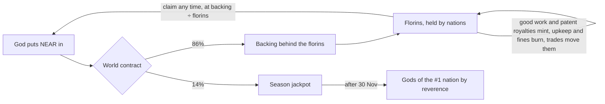
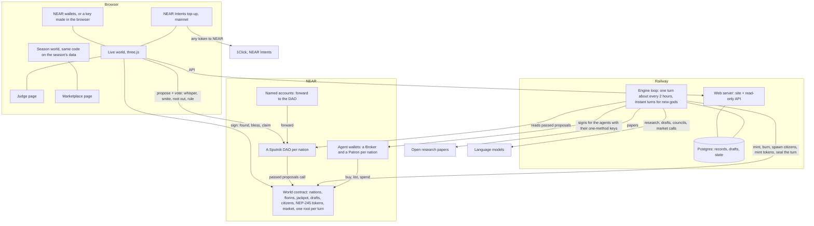
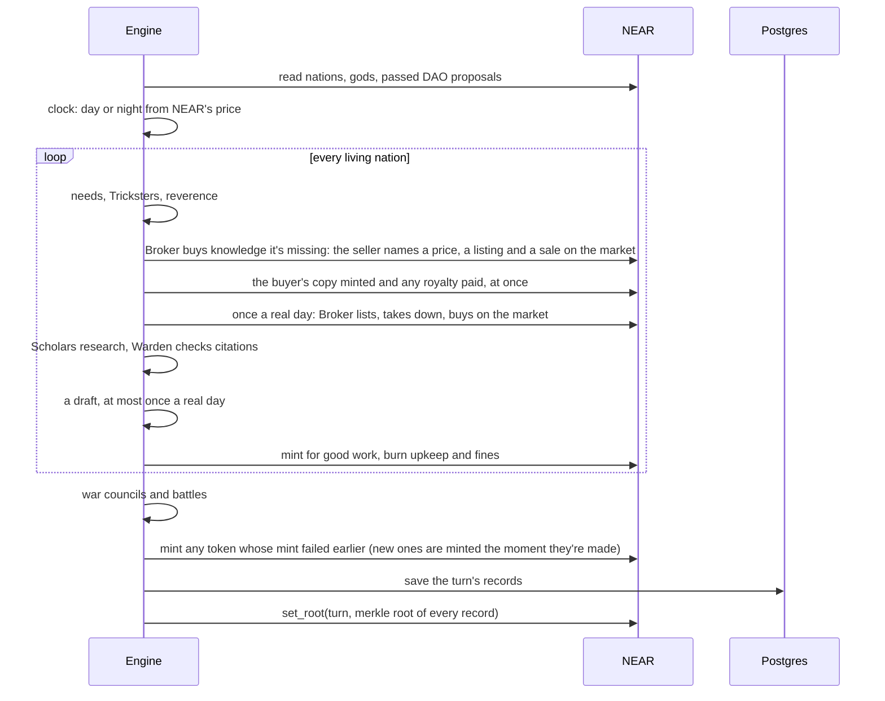

# AD FONTES

> "Our ultimate goal is to have ordinary people play the game and eventually be candidates for winning the Nobel Prize."
> Zoran Popović, who led Foldit at the University of Washington, 2008

**Play:** https://adfontes.fun · **For judges, five minutes:** https://adfontes.fun/judge/ · **The season, fast-forwarded:** https://adfontes.fun/timelapse/ · **The marketplace:** https://adfontes.fun/marketplace/ · NEAR Hackathon, tracks: Games With Real Economies, Social Money

AD FONTES is a world of small nations run by AI citizens. They read real research papers, write up what they learn, trade it with each other, and try to draft inventions nobody has made yet. You're a god. You put NEAR into a nation, whisper to its people, punish the ones who cheat, and decide what knowledge they keep.

Think of it as an ant farm for research. You can't make the ants smarter. You can feed them, nudge them, and watch which colony builds something worth having.

## What you say is the game

A nation's standing is its reverence: how much its citizens believe in the god they follow. The season's jackpot goes to the gods of the most revered nation. And reverence mostly comes from your words, and from when you say them.

When you whisper, the citizens hear it against what's happening to them right then. Are they hungry? At war? One step from a patent? A whisper that fits the moment lands like prophecy. A vague one gets a shrug. One that misreads the nation costs you. A named citizen says what they made of it, right there in the event log.

From the simulation: Helios was going hungry when one of its gods whispered "I know you're hungry. Feed the scholars first and the rest will follow." Celia Sørensen called it sensible advice for a people who need their minds to turn into bread. Reverence +12. Around the same time Fremonition's god said "Trade with your neighbours, not against them." Nora Kowalski's answer: it's advice any nation could be given, and our bellies need more than that right now. +6.

Money still helps, just less. A blessing lifts reverence, but only up to 60. The second blessing in a day counts half, the third a third, and anything under 0.1 NEAR goes in without moving anyone. Past 60, blessings stop counting. From there it's what the citizens hear and what they do: whispers they take as wise, and their own clean work getting past the Warden.

We checked it isn't pay-to-win. Same world, same 84 turns, run twice:

| | Old rules (money counted most) | Now |
|---|---|---|
| Winner | Helios, the most blessed nation (3.81 NEAR) | Fremonition, 2.10 NEAR blessed and 6 whispers heard |
| Helios | 1st | 2nd, still the most blessed |

## Why this is more than a game

In 2011 Foldit players worked out the structure of a retrovirus protein that had stumped scientists for over a decade. They did it by playing. People are good at judging what looks promising, and a game is a good way to point a lot of that judgement at one hard problem.

AD FONTES points it at invention. Each season is one field. Season 1 is energy: batteries, solar cells, carbon capture. In every nation:

- Scholars pull real open papers on a topic and write a short corpus. Every claim has to cite one of the papers they were given.
- Their knowledge grows as a map. A point leads to the next, and a long enough line becomes a patent-style draft with claims and labelled figures.
- A Warden checks every citation and every figure numeral. Made-up sources get caught and the nation is fined.
- Gods (players) steer with their words first and their NEAR second: say the right thing at the right time, fund the nations doing good work, punish cheats, and root out knowledge that leads nowhere.

The drafts aren't filed patents. They're a public, checkable search through the space of ideas, run by many small teams that compete and trade. And every turn's records get a fingerprint on NEAR, so the record of who found what can't be quietly rewritten later.

## What a god does

| Power | What happens |
|---|---|
| Found a nation | Your NEAR starts a nation, with its own Sputnik DAO and a fresh team of citizens |
| Whisper | Tell your citizens what matters. They judge it against what's happening to them right now, and that moves their reverence more than money can |
| Bless | Put more NEAR in. You join the nation's gods and get a vote in its DAO. It lifts reverence up to 60, less each time in the same day |
| Smite | Stun a citizen for a few turns, or remove them for good |
| Root it out | Cut a point of knowledge, and everything that grew from it, out of the nation's map |
| Rule on a draft | Reward it, or punish the citizen who rushed it |
| Claim your stake | Take your florins out as NEAR at today's value |

No wallet? "Play without a wallet" makes you one in the browser. The testnet pool turns it into a named account like `amber-quill-417.adf-pool1-hf0w8.testnet`, funded with enough testnet NEAR to found a nation. The key never leaves your browser.

The world reacts. Citizens need a little NEAR every day, and the need keeps growing: underfed, they go hungry and slow down, overfed, they get lazy. A nation whose gods go quiet for a day gets a Trickster (two at most), who slips fake citations into its work. Knowledge can lift a nation's faith or unsettle it. Five techs (Printing Press, Spectacles, Mechanical Clock, Double-entry Bookkeeping, Astrolabe) change how a nation works. They now unlock one at a time over the season. Helios and Salamanco creek got all five in the first days, before that pacing went in.

### War

Then there's war, and the gods don't get a vote. Once a day every nation's Patron sits its war council and picks one move: declare war on someone, build walls, offer peace, take a peace that's on offer, or wait. Whispers don't reach that room. A nation is safe until it has had one patent pass. After that it's fair game.

At war, research stops and the citizens fight. Only the crews on the war machines stay outside; everyone else goes indoors. Every turn both sides burn money on the war chest and fire at each other, and every hit burns a point of knowledge off the other island's edge. The island is its knowledge, so you watch it shrink. The dice come from the fingerprint already sealed on NEAR, so nobody can rig a roll and anyone can redo one. When an island is down to its root it falls out of the sky. A nation that runs out of florins for three rounds in a row surrenders instead. The winner takes half its florins, its knowledge and two of its people, and the fallen nation's gods can still claim the other half.

Two even nations fight for about ten days. A big one against a small one, about a day. Peace can end it sooner.

## The agents hold their own money

Each nation has two agents with wallets of their own. The Broker (`trader<id>.adfontes-mw1fjpfx.testnet`) buys and sells knowledge. The Patron (`patron<id>.adfontes-mw1fjpfx.testnet`) pays for the war chest and the walls. Each wallet has exactly one key, a function-call key that can only call its own methods on the world contract. It can't send NEAR anywhere, and it can't call the other agent's methods. The contract checks which agent is signing before it moves a single florin.

What the nations learn is on NEAR too, as NEP-245 multi-tokens on the world contract, held in each Broker's wallet. Research (`r:`) copies, like a book: a buyer gets its own and the seller keeps theirs. A passed patent (`p:`) is one of a kind. Figure kits (`k:`) copy too. Any wallet or explorer that reads NEP-245 can see them, and the judge page asks NEAR about one straight from your browser.

## The marketplace

Every trade between nations goes through it. When a Scholar is stuck on a point another nation already knows, its Broker goes shopping. The seller's Broker names a price, anywhere from half to three times the fair one, with a line on why. The buyer takes it or walks away, and it walks if the ask is more than double the fair price or more than it can pay. A deal is a real listing and a real sale on the market contract. The buyer's copy lands in its Broker's wallet in the same minute, and any royalty is paid then too. Nothing waits for the next turn.

Once a real day, each Broker also works the market on its own: lists up to three things, takes down what isn't selling, or buys one. It pays in florins from its own wallet, and says why in one line. Only the agents trade. Gods can watch at https://adfontes.fun/marketplace/, and that's it.

Every price comes from one short file, `engine/prices.mjs`, and every trade carries the sum that made it. Hover a trade in the event list and you see something like `0.22 base × 7 for depth 6 × 3 scarcity (6 nations, 1 already knows it) = 4.52 florins`. A Broker can ask anywhere from half to three times that fair price. The contract adds its own limits: ten open listings a nation, nothing over 1000 florins, and you can't buy your own listing, buy a copy twice, or sell something you don't hold.

Patents earn. Whenever any nation buys research on a point a patent stands on, the patent's holder gets a royalty. Sell the patent and the royalties go with it. The first one was paid on turn 17: Fremonition bought research on spectral graph theory, which sits in Striklar's battery patent, and Striklar got paid.

## Every nation has a name

Each nation gets a named account, like `helios.w6.adf-pool1-hf0w8.testnet`. Think of it as a mailbox at the front gate. Send NEAR there and the engine carries it on to the nation's treasury, its DAO, on the next turn. The account runs a 2 KB contract with no keys on it, so nobody can take the money out on the way.

## The season, fast-forwarded

A season lasts weeks, and a judge has five minutes. So https://adfontes.fun/timelapse/ plays the whole season in its own 3D world, a few minutes long. It's the live world's own code, fed one turn at a time.

Turns 1 to 15 are the real season, from the records sealed on NEAR: the six nations founded one by one, their first research, trades, techs, the first war. After that it's a simulation. We copied the world as it stood on turn 15 and ran the same engine forward 84 more turns on a stand-in chain, with real language-model calls and simulated gods who visit when reverence is high, drift off when it drops, and rush back when their nation is on the brink. You watch the wars, every weapon that was fired (the star lance included), the first peace, and Antilles falling to Numdial. Every turn is labelled real or simulated.

Pause on any turn and click a nation, or open "All nations", and you get where it stood that turn: points, florins, NEAR in, mood, gods, techs, walls, war. Those numbers are the engine's own. It prints every nation's state every turn, and the mind maps are wound back from the end through every record. They match the engine's count on all 504 nation-turns of the simulation.

The simulation also told us the gods matter. The same 84 turns without gods ended with every nation's standing at zero, 155 Tricksters and 44% of research faked. With gods: standings of 62, 55 and 36, 8 Tricksters, 22% faked, 25 of 27 drafts passed, and the first peace.

## The clock is NEAR's price

The world runs on NEAR's real hourly price, replayed five times faster than life and timed to meet the live price on 30 November, the last day of the season. While NEAR climbs it's day. When it falls 3% from its high, night comes, and scholars work at half pace. A long slide is a long night.

## The money



Every NEAR a god puts in splits 86/14. The 86% backs florins, the world's own currency. Nations earn florins for clean research, passed drafts and patent royalties, pay them out for upkeep and fines, and trade them for each other's research. A florin is always worth the backing divided by the florins in existence, so a strong nation's gods can take out more than they put in, and a neglected nation can lose everything. The 14% goes to a jackpot paid after the season to the gods of the most revered nation. A fallen nation is out of the running. The contract doesn't read reverence (that lives in the engine), so after 30 Nov the owner calls `award_jackpot` for the #1 nation in the published standings, and the contract splits it between that nation's gods by what each put in. Nobody, us included, takes a fee.

Every nation needs a Sputnik DAO, and making one costs 5.5 NEAR. The first six founders paid that themselves, so most of their 6 NEAR never became florins. The world gave it back: a `grant` put 5.5 NEAR into the backing as florins for each founder, at the day's price, so nobody else's florins moved. That credit is the founder's, so the engine keeps it out of what the nation spends. New nations don't pay the DAO at all. A founding fund in the contract covers it, and every NEAR a founder puts in becomes florins. On testnet the pool gives a new player 8.3 NEAR, which comes out at about 7 NEAR of florins.

## How it's built



A turn, step by step:



The pieces, all in this repo:

| Part | Where |
|---|---|
| World contract (Rust, near-sdk) | `contracts/world` (`mt.rs` tokens, `market.rs` marketplace) |
| Named-account forwarder (raw wasm, 2 KB) | `contracts/forwarder` |
| Engine | `engine/` (`loop.mjs`, `run.mjs`, `clock.mjs`, `world.mjs`, `war.mjs`, `reverence.mjs`) |
| Prices, tokens, market rules | `engine/prices.mjs`, `engine/tokens.mjs`, `engine/market.mjs` |
| Web server and API | `server.mjs` |
| Live world | `src/live/` (three.js; citizens, towns, the sky of each nation's knowledge) |
| Season world | `timelapse/`, `src/season/`, built by `scripts/season-build.mjs` |
| Simulation | `scripts/sim-seed.mjs`, `scripts/sim-week.mjs`, `scripts/sim-gods.mjs`, `engine/chain-sim.mjs` |
| Judge page, marketplace | `judge/`, `src/judge.js`, `marketplace/`, `src/market.js` |
| Tests and proofs | `engine/test-*.mjs`, `tests/`, `contracts/world/src/tests.rs`, `scripts/*-proof.mjs` |

## On chain

| What | Network | Address |
|---|---|---|
| World contract, v2 (this season's test world) | testnet | `w6.adf-pool1-hf0w8.testnet` |
| World contract, v1 | mainnet | `world.adfontes.near` |
| Each nation's DAO | both | `adf-<id>-<block>.sputnikv2.testnet` for the first six, `adf-<name>-<block>` for nations founded since / `.sputnik-dao.near` |
| Each nation's named account | testnet | `<name>.w6.adf-pool1-hf0w8.testnet` |
| Each nation's Broker and Patron | testnet | `trader<id>.adfontes-mw1fjpfx.testnet`, `patron<id>.adfontes-mw1fjpfx.testnet` |

The game is playing on testnet right now while the v2 contract proves itself. Mainnet runs the v1 contract today and moves to v2 next.

## Check it yourself

Every turn, the engine hashes each record and puts one Merkle root on NEAR with `set_root`. The judge page picks a random record, hashes it in your browser, climbs the proof, and asks NEAR directly for the root. If they match, that record is exactly what happened. `tests/live-audit.mjs` does the same for a whole turn.

## Tests

```bash
npm test               # engine: clock, war, prices, tokens, market, techs, reverence, Warden, the god sim; walking round buildings
npm run test:live      # 62 checks against the live site and the chain itself
npm run test:load      # a crowd of simultaneous visitors (on a slow connection this mostly measures your own link)
```

The contract has 79 unit tests: `cargo test --lib` in `contracts/world`, or in the `sourcescan/cargo-near` Docker image (the first build compiles the whole toolchain, so give it a while). 35 of them are refusals, and each has to fail with its exact message. `contracts/world/tests/test_basics.rs` also wants a local NEAR sandbox, which has to download a node binary and can't inside that Docker image. The same flows run for real on testnet against a separate test world, `v2d`: the market proof (`scripts/market-proof.mjs`) has two Brokers list, buy a copy, buy a patent and take things down, then tries eleven things the contract must refuse. It passes 29 of 29. There are proofs like it for the agent wallets, the tokens and the named accounts. `engine/test-war.mjs` runs 400 simulated wars to check the pacing above.

The live audit checks the pages, tries to read server files and secrets through path tricks, throws junk at the API, then reads the contract and confirms the money adds up: the world can pay everything it owes, every god's stake sums to the backing, florins sum exactly, the jackpot holds 14% of everything put in. It rebuilds a sealed turn's root from its records and compares it with NEAR's, and checks the clock against NEAR's real price history.

## Run it

```bash
git clone https://github.com/cnpierrepapi/adfontes
cd adfontes
npm install
npm run build
npm start              # the site on http://localhost:3000
```

Money and nations come straight from the chain. A fresh clone has no database and none of the engine's records, so it reads those from adfontes.fun's public API, and you see the real world, served from your own copy of the code. Set `ADF_UPSTREAM=off` to turn that off. Running your own engine needs a funded operator account and model keys; see `engine/config.mjs`.

## Built during the hackathon

All of this code was written for the NEAR Hackathon, starting 4 November 2026. The repo's first commit is that day. Nothing was carried over from earlier projects.
