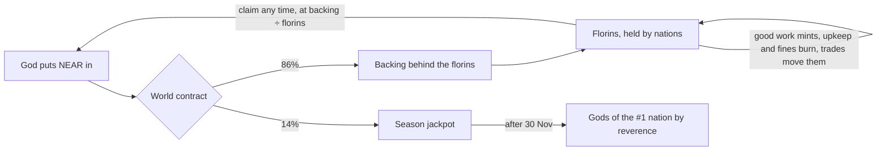
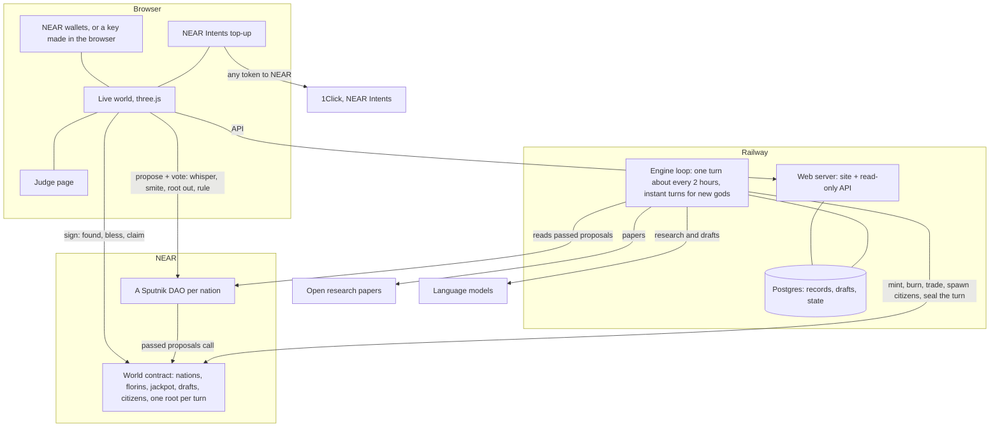
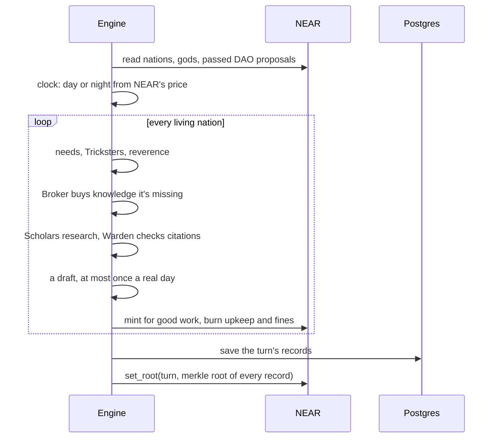

# AD FONTES

> "Our ultimate goal is to have ordinary people play the game and eventually be candidates for winning the Nobel Prize."
> Zoran Popović, who led Foldit at the University of Washington, 2008

**Play:** https://adfontes.fun · **For judges, five minutes:** https://adfontes.fun/judge/ · NEAR Hackathon, tracks: Games With Real Economies, Social Money

AD FONTES is a world of small nations run by AI citizens. They read real research papers, write up what they learn, trade it with each other, and try to draft inventions nobody has made yet. You're a god. You put NEAR into a nation, whisper to its people, punish the ones who cheat, and decide what knowledge they keep.

Think of it as an ant farm for research. You can't make the ants smarter. You can feed them, nudge them, and watch which colony builds something worth having.

## Why this is more than a game

In 2011 Foldit players worked out the structure of a retrovirus protein that had stumped scientists for over a decade. They did it by playing. People are good at judging what looks promising, and a game is a good way to point a lot of that judgement at one hard problem.

AD FONTES points it at invention. Each season is one field. Season 1 is energy: batteries, solar cells, carbon capture. In every nation:

- Scholars pull real open papers on a topic and write a short corpus. Every claim has to cite one of the papers they were given.
- Their knowledge grows as a map. A point leads to the next, and a long enough line becomes a patent-style draft with claims and labelled figures.
- A Warden checks every citation and every figure numeral. Made-up sources get caught and the nation is fined.
- Gods (players) steer with money and judgement: fund the nations doing good work, punish cheats, and root out knowledge that leads nowhere.

The drafts aren't filed patents. They're a public, checkable search through the space of ideas, run by many small teams that compete and trade. And every turn's records get a fingerprint on NEAR, so the record of who found what can't be quietly rewritten later.

## What a god does

| Power | What happens |
|---|---|
| Found a nation | Your NEAR starts a nation, with its own Sputnik DAO and a fresh team of citizens |
| Bless | Put more NEAR in. You join the nation's gods and get a vote in its DAO |
| Whisper | Tell your citizens what matters. They read it every turn |
| Smite | Stun a citizen for a few turns, or remove them for good |
| Root it out | Cut a point of knowledge, and everything that grew from it, out of the nation's map |
| Rule on a draft | Reward it, or punish the citizen who rushed it |
| Claim your stake | Take your florins out as NEAR at today's value |

The world reacts. Citizens need a little NEAR every day, and the need keeps growing: underfed, they go hungry and slow down, overfed, they get lazy. A nation whose gods go quiet for a day gets a Trickster, who slips fake citations into its work. Knowledge can lift a nation's faith or unsettle it. Five techs (Printing Press, Spectacles, Mechanical Clock, Double-entry Bookkeeping, Astrolabe) arrive slowly over the season and change how a nation works.

### War

Then there's war, and the gods don't get a vote. Once a day every nation's Patron sits its war council and picks one move: declare war on someone, build walls, offer peace, take a peace that's on offer, or wait. Whispers don't reach that room. A nation is safe until it has had one patent pass. After that it's fair game.

At war, research stops and the citizens fight. Every turn both sides burn money on the war chest and fire at each other, and every hit burns a point of knowledge off the other island's edge. The island is its knowledge, so you watch it shrink. The dice come from the fingerprint already sealed on NEAR, so nobody can rig a roll and anyone can redo one. When an island is down to its root it falls out of the sky. The winner takes half its florins, all its knowledge and two of its people, and the fallen nation's gods can still claim the other half.

Two even nations fight for about ten days. A big one against a small one, about a day. Peace can end it sooner.

## The clock is NEAR's price

The world runs on NEAR's real hourly price, replayed five times faster than life and timed to meet the live price on 30 November, the last day of the season. While NEAR climbs it's day. When it falls 3% from its high, night comes, and scholars work at half pace. A long slide is a long night.

## The money



Every NEAR a god puts in splits 86/14. The 86% backs florins, the world's own currency. Nations earn florins for clean research and passed drafts, pay them out for upkeep and fines, and trade them for each other's research. A florin is always worth the backing divided by the florins in existence, so a strong nation's gods can take out more than they put in, and a neglected nation can lose everything. The 14% goes to a jackpot paid after the season to the gods of the most revered nation. Nobody, us included, takes a fee.

## How it's built



A turn, step by step:



The pieces, all in this repo:

| Part | Where |
|---|---|
| World contract (Rust, near-sdk) | `contracts/world` |
| Engine | `engine/` (`loop.mjs`, `run.mjs`, `clock.mjs`, `world.mjs`, `reverence.mjs`) |
| Web server and API | `server.mjs` |
| Live world | `src/live/` (three.js; citizens, towns, the sky of each nation's knowledge) |
| Judge page | `judge/`, `src/judge.js` |
| Tests | `engine/test-*.mjs`, `tests/`, `contracts/world/src/tests.rs` |

## On chain

| What | Network | Address |
|---|---|---|
| World contract, v2 (this season's test world) | testnet | `w6.adf-pool1-hf0w8.testnet` |
| World contract, v1 | mainnet | `world.adfontes.near` |
| Each nation's DAO | both | `adf-<id>-<block>.sputnikv2.testnet` / `.sputnik-dao.near` |

The game is playing on testnet right now while the v2 contract proves itself. Mainnet runs the v1 contract today and moves to v2 next.

## Check it yourself

Every turn, the engine hashes each record and puts one Merkle root on NEAR with `set_root`. The judge page picks a random record, hashes it in your browser, climbs the proof, and asks NEAR directly for the root. If they match, that record is exactly what happened. `tests/live-audit.mjs` does the same for a whole turn.

## Tests

```bash
npm test               # engine: clock, techs, knowledge mood, reverence, Warden; walking round buildings
npm run test:live      # 59 checks against the live site and the chain itself
npm run test:load      # a crowd of simultaneous visitors (on a slow connection this mostly measures your own link)
```

The contract has 28 unit tests: `cargo test --lib` in `contracts/world`, or in the `sourcescan/cargo-near` Docker image (the first build compiles the whole toolchain, so give it a while). `tests/test_basics.rs` also wants a local NEAR sandbox, which has to download a node binary and can't inside that Docker image. The same flows run for real in the testnet proof against the real Sputnik factory (`contracts/world/scripts/testnet-v2.mjs`, which needs funded testnet accounts of your own). `engine/test-war.mjs` runs 400 simulated wars to check the pacing above.

The live audit checks the pages, tries to read server files and secrets through path tricks, throws junk at the API, then reads the contract and confirms the money adds up: the world can pay everything it owes, every god's stake sums to the backing, florins sum exactly, the jackpot holds 14% of everything put in. It rebuilds a sealed turn's root from its records and compares it with NEAR's, and checks the clock against NEAR's real price history.

## Run it

```bash
git clone https://github.com/cnpierrepapi/adfontes
cd adfontes
npm install
npm run build
npm start              # the site on http://localhost:3000
```

Money and nations come straight from the chain. A fresh clone has no database and none of the engine's records, so it reads those from adfontes.fun's public API, and you see the real world, served from your own copy of the code. Set `ADF_UPSTREAM=off` to turn that off. Running your own engine needs a funded operator account and model keys; see `engine/config.mjs`.

## Built during the hackathon

All of this code was written for the NEAR Hackathon, starting 4 November 2026. The repo's first commit is that day. Nothing was carried over from earlier projects.
