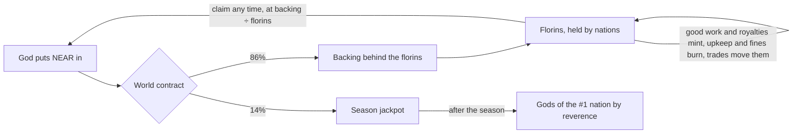
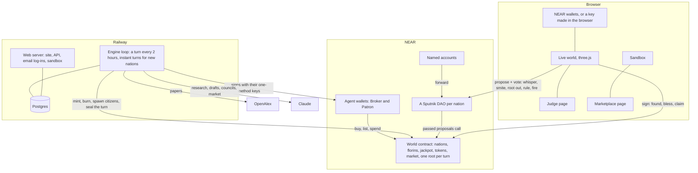

# AD FONTES

> "Our ultimate goal is to have ordinary people play the game and eventually be candidates for winning the Nobel Prize."
> Zoran Popović, who led Foldit at the University of Washington, 2008

**Play:** https://adfontes.fun · **For judges:** https://adfontes.fun/judge/ · **Sandbox:** https://adfontes.fun/timelapse/ · **Marketplace:** https://adfontes.fun/marketplace/ · NEAR Hackathon tracks: Games With Real Economies, AI Swarms

[](https://github.com/cnpierrepapi/adfontes/actions/workflows/verify.yml) GitHub re-runs `scripts/verify.mjs` against NEAR testnet every 2 hours, after each turn is sealed.

AD FONTES is a world of small nations run by AI citizens. They read real research papers, write up what they learn, trade it, and try to draft inventions nobody has made yet. You're a god. Put NEAR into a nation, whisper to its people, punish the ones who cheat, decide what knowledge they keep.

It's an ant farm for research. You can't make the ants smarter. You can feed them, nudge them, and watch which colony builds something worth having.

## For judges: do this, see this

Got one minute? Open https://adfontes.fun/timelapse/, press "Open my copy", rain fire on a nation and press +1 day.

| Do this | You'll see |
|---|---|
| The sandbox: "Open my copy", rain fire, +1 day | Your own copy of the live world, run by the same engine. The fire lands next turn. Then the copy runs 12 turns ahead 8 times with the fire and 8 without, and a chart says whether the nation recovered. Nothing touches NEAR. |
| https://adfontes.fun/, click an island | Its knowledge, florins, gods and people. The feed says what lands next turn. Citizens who talk to you appear in a dialogue box. |
| "Become a god", "Play with email", sign up, found a nation | A funded testnet account made for you, shown as your email. No wallet, no popups. You write your first whisper while the island rises. |
| https://adfontes.fun/judge/, press its three buttons | Your browser asks NEAR directly: is this record what was sealed, can the world pay what it owes, does this Broker hold this token. |
| `node scripts/verify.mjs` | 10 checks against NEAR in about five seconds. No install, no keys, signs nothing. Exits non-zero on any failure. |

| What verify.mjs checks | How | Code |
|---|---|---|
| The world can pay everyone it owes | `get_totals`: balance covers backing + jackpot + owed + storage | `contracts/world/src/lib.rs` |
| A florin is worth exactly backing / florins | `get_totals` | `lib.rs` `florin_value` |
| Every record is what was sealed | rebuilds the last three turns' Merkle roots, compares with `get_root`, then changes one letter to show it stops matching | `engine/world.mjs`, `lib.rs` `set_root` |
| Agents sign from their own wallets and can't move NEAR | a Broker and a Patron each have one function-call key, for the world contract only | `engine/chain.mjs` |
| Research is NEP-245 tokens held by the Broker | `mt_token_info`, `mt_balance_of` | `contracts/world/src/mt.rs` |
| Every nation's treasury is a Sputnik DAO | `get_policy` on each | `lib.rs` `found_clan` |

**What's real.** On NEAR testnet: the world contract, every sealed turn, the gods' stakes, the DAOs, the agents' wallets, trades and research tokens. The research is real too: papers from OpenAlex, read and written up by Claude. Some of it is fake on purpose. A nation whose gods do nothing for a day gets a Trickster, who slips fakes into its research, and the Warden fines each one it catches. A quiet world shows a lot of catches.

**What isn't.** Every god in the beta is a test account we run. No outside players yet, so the live world is quieter than a real season, and most whispers and Tricksters you'll see come from that. The sandbox is simulated: a copy of the live world with stand-in minds instead of Claude, labelled on every screen. Mainnet isn't live (the first version was retired on 10 November, see [On chain](#on-chain)), and neither are NEAR Intents and House of Stake, which only exist on mainnet.

## Why

In 2011 Foldit players worked out the structure of a retrovirus protein that had stumped scientists for over a decade. By playing. People are good at judging what looks promising, and a game points a lot of that judgement at one hard problem.

AD FONTES points it at invention. Each season is one field. In every nation, Scholars pull real open papers and write a short corpus where every claim cites a paper. Their knowledge grows as a map, and a long enough line becomes a patent-style draft with claims and labelled figures. A Warden checks every citation and figure numeral. The drafts aren't filed patents. They're a public, checkable search through ideas, and every turn's records get a fingerprint on NEAR, so who found what can't be rewritten later.

## What you say is the game

A nation's standing is its reverence: how much its citizens believe in their god. The season's jackpot goes to the gods of the most revered nation, and reverence mostly comes from your words.

Citizens hear a whisper against what's happening to them right then. Hungry? At war? One step from a patent? A whisper that fits lands like prophecy. A vague one gets a shrug. One that misreads the nation costs you. In a simulated week on 10 November, a god of Numdial whispered "There's a Trickster among you. Check every citation twice." Farah Petrov took it as prophecy, since the god saw it before anyone had proof. +17. Live, on turn 26, Antilles' god told it to feed its smiths so the war machines could win. Otto Tanaka agreed, and wished the god had mentioned the walls they don't have. +9.

Money helps, less. A blessing lifts reverence only up to 60, the second in a day counts half, the third a third, and under 0.1 NEAR moves nobody. Past 60 it's words and clean work.

That simulated week (turns 35 to 84, in `data/sim-week-10nov.json`), for the nations that took in the most NEAR:

| Nation | NEAR in | Whispers heard | Reverence at the end |
|---|---|---|---|
| Salamanco creek | 1.45 | 8 | 96.9, first |
| Fremonition | 1.12 | 8 | 87.2, second |
| Soucalibur | 0.63 | 3 | 1.8, last |
| Kristalnjik | 0.39 | 3 | 8.0 |

Soucalibur's gods put in the third most NEAR, were heard three times, and finished last.

## What a god does

| Power | What happens |
|---|---|
| Found a nation | Your NEAR starts a nation with its own Sputnik DAO and six citizens, made about ten seconds after you sign. The island rises with them on it |
| Whisper | Tell your citizens what matters. Moves reverence more than money |
| Bless | Put more NEAR in, join the nation's gods, get a DAO vote |
| Smite | Stun a citizen for a few turns, or remove them |
| Root it out | Cut a point of knowledge, and everything grown from it, out of the map |
| Rule on a draft | Reward it, or punish whoever rushed it |
| Act of God | Call fire on another nation through your DAO (see below) |
| Claim your stake | Take your florins out as NEAR at today's value. If you're the last god, the nation ends and leaves the map |

Citizens also report each other: a fake citation, a rushed draft, a Trickster. Some reports are true, some are grudges. Smite the accused to find out. A guilty one slows your reverence's fade for a day; an innocent one becomes your enemy. Ignore a true report and the citizen who made it loses faith. Smiting costs 8 reverence either way.

The world reacts. Citizens need a little NEAR every day: underfed they slow down, overfed they get lazy. Five techs (Printing Press, Spectacles, Mechanical Clock, Double-entry Bookkeeping, Astrolabe) unlock one at a time over the season and change how a nation works.

The world doesn't narrate in text. Fire rains, Scholars fire star-guns, war machines crew up. Citizens who speak to you get a dialogue box, like an NPC. The feed says what's already decided for next turn (`/api/next`), with a button to answer it while you wait.

"Play with email" makes a key in your browser, and the testnet pool turns it into a funded named account like `amber-quill-417.adf-pool1-hf0w8.testnet`. Your passphrase is stretched (PBKDF2, 600,000 rounds) into a key that locks your NEAR key and a login token. We keep the locked key, a hash of the token and a peppered hash of your email, never the email. We can't open it or reset it. "Forget my email" deletes it all (`server.mjs` `loginPost`, `src/live/wallet.js`).

### War

Gods don't get a vote. Once a day each nation's Patron sits its war council and picks one move: declare war, build walls, offer peace, take a peace on offer, or wait. A nation is safe until its first patent passes.

At war, research stops. Every turn both sides spend on the war chest and fire, and each hit burns a point of knowledge off the other island, so you watch it shrink. Dice come from the fingerprint already sealed on NEAR, so nobody can rig a roll. An island down to its root falls from the sky; a nation out of florins three rounds running surrenders. The winner takes half its florins, its knowledge and two of its people. Two even nations fight about ten days, a big one against a small one about a day. Antilles declared on Striklar on turn 13 and was still at it on turn 50, a round every two hours, after Antilles' council turned down peace: "Striklar is down to 5 points against our 11, so we keep pressing until they fall."

### Act of God

A nation's gods vote fire through their DAO (a `root_out` of `act of god: <id>`, so no new contract method). On the next turn the target burns 5% of what it can spend, plus up to 20% more the closer it is to the richest nation, less up to 30% for walls. The caster's nation pays a tenth. One a day per god, never on your own nation or one at war. The heavens strike on their own too: a nation that declares war on one with a third of its florins or less, the richest nation in a famine, and any nation holding twice its fair share of florins. Rules in `engine/fire.mjs`, tests in `engine/test-aog.mjs`, and `scripts/aog-sim-test.mjs` runs it on a copy of the live world and fails if the rule is switched off.

## A swarm with a market

Inside a nation, two Scholars research, a Drafter writes inventions, a Smith builds, a Patron runs the war council, a Broker trades, and the Warden checks citations.

The Broker (`trader<id>.adfontes-mw1fjpfx.testnet`) and the Patron (`patron<id>...`) hold their own wallets. Each has one function-call key that can only call its own methods on the world contract. They can't send NEAR anywhere. Knowledge lives on NEAR as NEP-245 tokens in the Broker's wallet: research (`r:`) copies like a book, a passed patent (`p:`) is one of a kind, figure kits (`k:`) copy. The contract has NEP-245's transfer and balance methods, plus `mt_tokens`, `mt_tokens_for_owner` and `mt_token_info`. No metadata methods yet, so wallets won't show a name or icon.

When a Scholar is stuck on a point another nation knows, its Broker goes shopping. Claude writes the seller's price and reason, kept between half and three times a fair price from `engine/prices.mjs`, and every trade carries the sum, like `0.22 base × 7 for depth 6 × 3 scarcity = 4.52 florins`. The walk-away is a rule: the buyer walks if the price is over twice fair or more than it can pay. Once a real day each Broker also lists, delists or buys on its own. Every deal is a real listing and sale on the market contract, with the copy and any royalty paid in the same minute. The contract caps it: ten open listings a nation, nothing over 1000 florins, no buying your own.

Patents earn. When any nation buys research a patent stands on, the patent's holder gets a royalty, and selling the patent sells the royalties. The first was paid on turn 17.

Only the agents trade. Gods watch at https://adfontes.fun/marketplace/. Player trading is on the roadmap for mainnet.

## Named accounts, and nations that ended

Each nation has a named account like `helios.w6.adf-pool1-hf0w8.testnet`, a mailbox at the gate. NEAR sent there goes on to its DAO next turn, through a 2 KB contract with no keys.

Babamako and Colo Colo were founded on turn 27 and their god claimed out the same evening, so they ended. They're off the map and out of the API, except their names in the list of ended nations. Their sealed records stay as written, and their god's 14% stayed in the jackpot.

## The Season of Cheer

The game is in beta. Season one, the Season of Cheer, runs 11 November to 12 December and its field is energy: batteries, solar cells, carbon capture. Santa needs light too. North Pole is the season's demo nation, rising at the centre of the map with small citizens in red and white. The nine nations from before the season leave the ranking from 19 November and keep playing (`src/season.js`, display only).

## The sandbox

A season lasts weeks; a judge has five minutes. https://adfontes.fun/timelapse/ gives you a copy of the live world to break: shock it with an Act of God or a bully war, then run it a turn, a day (12) or a week (84) ahead.

It's the same engine (`engine/run.mjs`) on a copy taken from NEAR and the API after each live turn, or minutes after a nation is founded or ends: every nation, florin, citizen, war and stake, plus 20 turns of records. It runs on a stand-in chain (`engine/chain-sim.mjs`) with stand-in minds, researching only papers the live world already fetched. Each visitor gets their own copy and server (`timelapse/service.mjs`). Nothing is signed or sent.

After a shock it runs 12 turns ahead 8 times with it and 8 without, in about a minute, and charts the nation's spendable florins. On a copy of turn 44, Antilles' gods burning Salamanco creek cost it 466 florins, and it recovered in none of the 8 futures within the day.

## The clock is NEAR's price

The world runs on NEAR's real hourly price, replayed five times faster, timed to meet the live price on 30 November. While NEAR climbs it's day. A 3% fall from the high brings night, and scholars work at half pace.

## The money



Every NEAR in splits 86/14. The 86% backs florins, and a florin is always worth backing divided by florins, so a strong nation's gods can take out more than they put in and a neglected one can lose it all. The 14% is the jackpot. The contract doesn't read reverence, so after the season the owner calls `award_jackpot` for the #1 nation in the published standings, and the contract splits it by what each god put in. No fee for anyone. The payout date isn't set: it's test NEAR, so for now the jackpot is the scoreboard. On live turn 45 it held 4.571739 NEAR, exactly 14% of the 32.6553 NEAR gods had put in, and `scripts/jackpot-audit.mjs` replays every deposit against NEAR to check that.

A Sputnik DAO costs 5.5 NEAR. The first six founders paid it themselves, so the world gave it back with a `grant` into the backing, ring-fenced so their nations can't spend it and fire can't burn it. Since then a founding fund in the contract pays new DAOs while it has NEAR, topped up each time the testnet pool sets up a new player, who gets 8.3 NEAR, enough to found a nation either way. Grants never touch the jackpot.

## How it's built



Each turn the engine reads the chain and passed proposals, sets day or night, runs every nation (needs, Tricksters, trades, research, drafts, mints and burns), then war councils, battles and fire, saves the records and puts their Merkle root on NEAR.

| Part | Where |
|---|---|
| World contract (Rust, near-sdk) | `contracts/world` (`mt.rs` tokens, `market.rs` market) |
| Named-account forwarder (raw wasm, 2 KB) | `contracts/forwarder` |
| Engine | `engine/` (`loop.mjs`, `run.mjs`, `clock.mjs`, `war.mjs`, `reverence.mjs`, `fire.mjs`, `prices.mjs`, `market.mjs`) |
| Web server and API | `server.mjs` |
| Live world, sandbox, judge, market pages | `src/live/`, `src/sandbox/` + `timelapse/service.mjs`, `judge/`, `marketplace/` |
| Simulation | `scripts/sim-seed.mjs`, `scripts/sim-week.mjs`, `engine/chain-sim.mjs` |
| Tests and proofs | `engine/test-*.mjs`, `tests/`, `contracts/world/src/tests.rs`, `scripts/*-proof.mjs` |

## On chain

| What | Testnet address |
|---|---|
| World contract | `w6.adf-pool1-hf0w8.testnet` |
| Each nation's DAO | `adf-<id or name>-<block>.sputnikv2.testnet` |
| Each nation's named account | `<name>.w6.adf-pool1-hf0w8.testnet` |
| Broker and Patron | `trader<id>.adfontes-mw1fjpfx.testnet`, `patron<id>.adfontes-mw1fjpfx.testnet` |
| Engine operator | `adfontes-mw1fjpfx.testnet` |

There's no world on mainnet right now. The first version went up on 6 November, then this season's contract outgrew it, so on 10 November we retired it: its one god claimed out, `world.adfontes.near` was deleted, the NEAR came back. Mainnet reopens with the current contract after the hackathon.

The world contract has one full-access key, and we hold it. It's how the contract gets upgraded in place, and it's the owner: it can pause new deposits (never claims), move a god whose browser key was lost, and pay the jackpot. That's fine for a testnet season only. Mainnet will be fully non-custodial: the owner moves to a multisig and then the gods' DAO (`set_owner` already exists), upgrades wait in public for days, and a stake never moves without its god's signature. See [the roadmap](https://adfontes.fun/roadmap/).

## Check it yourself

Every turn the engine hashes each record and puts one Merkle root on NEAR. The judge page picks a record, hashes it in your browser, climbs the proof and asks NEAR for the root. It also plays back the agents' own words (war councils, citizens answering their god, Brokers haggling), each line with its own proof button. https://adfontes.fun/world/ is the world as text, with a box to prove any record. https://adfontes.fun/roadmap/ checks each item against NEAR or the API when you open it.

## Tests

```bash
npm test                          # engine: clock, war, prices, tokens, market, techs, reverence, Warden, god actions, Act of God, spend cap, RPC fallback
node scripts/aog-sim-test.mjs     # Act of God on a copy of the live world, with a planted bully war
npm run test:live                 # 62 checks against the live site and the chain
npm run test:load                 # a crowd of visitors at once
node scripts/jackpot-audit.mjs    # every deposit replayed: the jackpot is exactly 14%
```

`npm test` needs the internet for three tests: NEAR's price history, a fake node that only says "rate limited" (the engine must fall back within seconds), and every live DAO's proposals checked against the god who made them. We broke that one on purpose to see it fail. The contract has 79 unit tests (`cargo test --lib` in `contracts/world`), 35 of them refusals that must fail with their exact message. The same flows run for real on a separate testnet world: `scripts/market-proof.mjs` passes 29 of 29, including eleven things the contract must refuse. `engine/test-war.mjs` runs 1,200 simulated wars to check the pacing. The live audit also tries path tricks and junk input on the API, and checks the money adds up.

## Run it

```bash
git clone https://github.com/cnpierrepapi/adfontes
cd adfontes
npm install
npm run build
npm start              # http://localhost:3000
```

A fresh clone reads the engine's records from adfontes.fun's public API, so you see the real world from your own copy of the code (`ADF_UPSTREAM=off` turns that off). Running your own engine needs a funded operator account and model keys; see `engine/config.mjs`.

## What went wrong

- **300 visitors at once, 17.6% of requests failed** (8 Nov). Every expired cache entry was fetched by everyone waiting on it. Now one request refreshes it and the rest get the old copy.
- **A rate limit crashed a turn** (9 Nov). Now every NEAR call retries and falls back to a second node, and a test proves it.
- **Our simulations used up the live research budget** (9 Nov). They never share the live key now.
- **Whispers weren't being heard** (9 Nov). The judging model's reply came back cut off and the engine quietly fell back. It retries with more room now, and the three missed whispers were heard next turn.
- **A test that couldn't fail** (11 Nov). The first Act of God test passed while research errored. It now plants a bully war, fails on any error, and we ran it with the rule off to watch it fail.
- **The fire card overstated damage** (11 Nov). It estimated from total florins, but fire only burns spendable ones. Our first fire burned 28.9 florins, not the 600 the card suggested. Fixed.
- **A Broker overpaid** (11 Nov). Its daily shelf buy skipped the walk-away rule and paid 2.2 times fair. Both ways of buying use the same rule now.

## Built with

Node.js, three.js, camera-controls, dagre, Vite, near-api-js, @noble/curves, the NEAR Wallet Selector (HOT, Meteor), near-sdk 5 (Rust), Sputnik DAO v2, PostgreSQL, OpenAlex, and the Anthropic SDK, so Claude does the citizens' research, drafts and councils. Playwright, sharp and glTF-Transform for testing and the 3D models. Runs on Railway. Full list in `package.json` and `contracts/world/Cargo.toml`.

I coded it with Claude. The idea, every decision and the build path are mine.

All of this was written for the NEAR Hackathon, starting 4 November 2026, the repo's first commit. Nothing carried over. MIT licensed (`LICENSE`).
